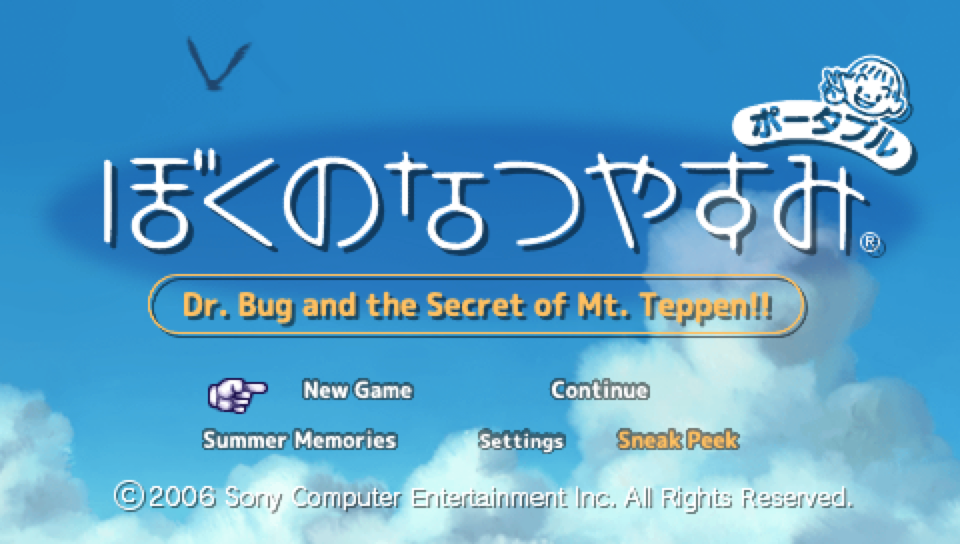
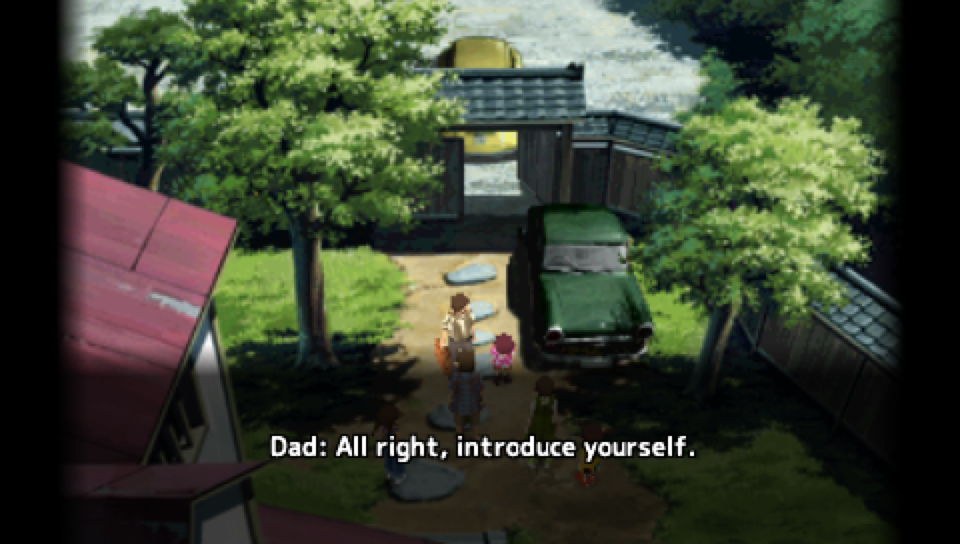
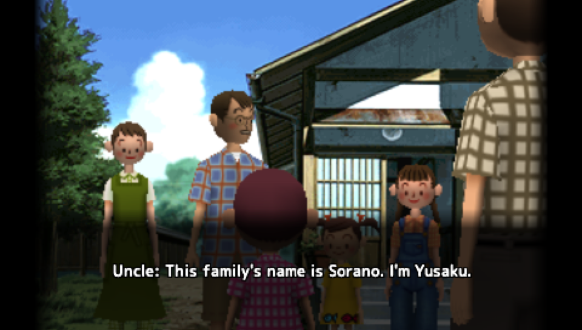

# Boku no Natsuyasumi Portable: English translation patch

[](LICENSE)
[](#ai-assistance-and-approach)
[](../../releases/latest)
[](#requirements)
[](#applying-the-patch)

```
 GAME ........ ぼくのなつやすみ ポータブル
               ムシムシ博士とてっぺん山の秘密!!
 ROM ......... Boku no Natsuyasumi Portable (Japan)
 PLATFORM .... Sony PlayStation Portable (PSP)
 ID .......... UCJS10038
 REGION ...... Japan
 BUILD ....... 40
 FORMAT ...... xdelta3 patch, no game data included
```

**Fully playable.** All the text has been translated programmatically, and it is now being confirmed on a
physical PSP. Display issues may still turn up. [docs/STATUS.md](docs/STATUS.md) has the current list. If
something is broken or still in Japanese, open an issue with a screenshot; corrections and contributions are
welcome.

The repo holds no game files. The four screenshots are the only game art in it, and you need your own copy
of the Japanese game. The patch is on the [Releases](../../releases) page.

## AI assistance and approach

This is an AI-assisted translation. Both the translation and the review pass were done by AI, working from a
standing directive to keep the tone and feel of the original.

The aim is to stay close to the original instead of paraphrasing it. Each speaker keeps their own register
and voice: the boy's narration, the adults' rural speech, the uncle's gruff asides. The English should feel
like a rural summer in the 1970s and should not read like modern internet slang. Jokes and wordplay work in
English where an equivalent exists; where it does not, the original joke stays visible. Names, honorifics and
forms of address follow Japanese usage.

It has not been reviewed by a native speaker, so corrections are welcome.

## Screenshots

| | |
|---|---|
|  |  |
|  |  |

## Requirements

- Your own untouched Japanese disc image:
  - size `397,508,608` bytes
  - SHA-1 `c7c9549fe565ee2702512a93a97353be208dd2cd`
- A browser patcher such as [RomPatcher.js](https://www.marcrobledo.com/RomPatcher.js/), or `xdelta3`
- [PPSSPP](https://www.ppsspp.org/), or a PSP running custom firmware

## Applying the patch

### In a browser (no install)

[RomPatcher.js](https://www.marcrobledo.com/RomPatcher.js/) by Marc Robledo handles xdelta and runs in the
page, so the files never leave your machine.

1. Open <https://www.marcrobledo.com/RomPatcher.js/>.
2. **ROM file:** select your untouched Japanese ISO.
3. **Patch file:** select `bnn-portable-en.xdelta`.
4. **Apply patch**, then **Download** the patched ISO.

### On the command line

```bash
xdelta3 -d -s "original.iso" bnn-portable-en.xdelta "Boku no Natsuyasumi Portable (English).iso"
```

## What is translated

- Story: all 2,288 messages of dialogue, narration, hints and choices, shown as centred subtitles. The
  English is drawn horizontally even where the original was vertical.
- Interface: all 459 text blocks, covering item names and notes, insect names and specimen entries, kite
  names, fishing notes, bug sumo and cage prompts, save/load and Favorites messages, Summer Memories menus,
  settings and controls help.
- Graphics: title menu and subtitle, settings screen, speech bubbles, plaques and buttons, fishing labels,
  sumo result cards and move names, specimen page, radio exercise card, 8 kite book pages, 17 insect guide
  pages (day and night), both book covers, all 98 picture diary pages, kite gauges, ending caption.
- Text baked into the executable: the "Caught" line, win/loss marks, fortunes, the kite crash box, fish names.
- XMB: game title, icon caption and splash text.
- Fonts: M PLUS Rounded 1c for dialogue and menus, Patrick Hand for the diary pages.

Videos and other image assets are still untranslated.

## Proofreading

[docs/translation-table.tsv](docs/translation-table.tsv) lists every story message with its id, speaker, source
file and the Japanese next to the English. To fix a line, edit its id in `work/tr/<file>.txt` and send a PR or
an issue.

## Credits

- Translation, review and tooling: AI-assisted (see *AI assistance and approach*).
- Fonts: M PLUS Rounded 1c, © 2016 The Rounded M+ Project Authors, SIL OFL 1.1. Patrick Hand,
  © 2010-2012 Patrick Wagesreiter, SIL OFL 1.1. Both under [licenses/](licenses/).
- Code and translation text: MIT ([LICENSE](LICENSE)). That covers the tools, scripts and translation text in this repo; the game itself, its art, music and original text belong to their owners and are not included.

Fan translation. Not affiliated with, sponsored by or endorsed by Sony Computer Entertainment or the
original developers and publishers. The game, its art, music and text remain the property of their owners.
This patch ships no game data and is useless without a legitimate copy of the original disc.

Do not ask for ISOs, and do not post them here.
